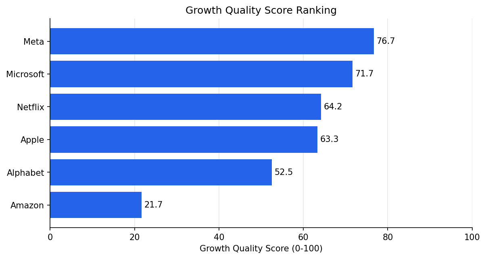
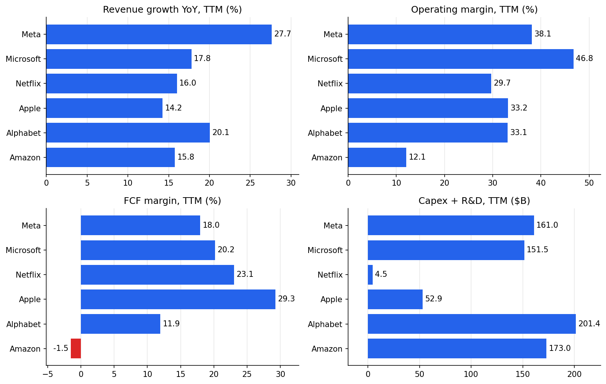
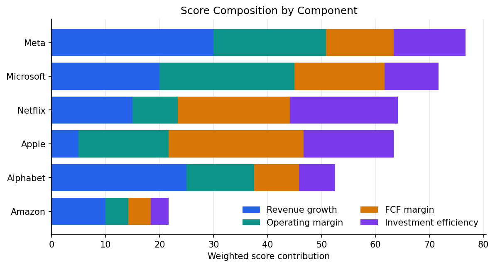
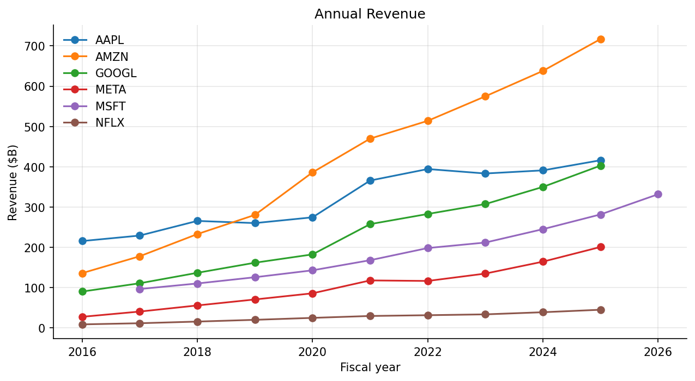

# FAANGM-growth-quality

SEC 공시(XBRL) 기반 FAANGM 6개사 성장의 질 비교 분석



## 1. 문제 정의

### 분석 목적

- 매출 성장률 하나로는 성장의 질 판단 불가
- 매출이 같은 속도로 늘어도 이익률, 현금 창출력, 투자 부담에 따라 성장의 지속 가능성 상이
- 성장률, 영업이익률, FCF 마진, 투자 효율 4개 지표를 한 점수로 묶어 6개사(Meta, Microsoft, Netflix, Apple, Alphabet, Amazon) 상대 비교

### 데이터

- 출처: SEC Company Facts API (기업이 제출한 10-K, 10-Q의 XBRL 수치)
- 선정 이유: 6개사 모두 같은 회계 기준(US GAAP)과 같은 항목 정의로 공시, 재무제표 수치를 직접 내려받아 기업 간 비교 가능
- 사용 항목: 매출, 영업이익, 영업활동 현금흐름(CFO), 설비투자(Capex), R&D

### 비교 기준

- 최근 4개 분기 합(TTM), 2026-06 분기 종료 기준 (Apple만 회계 분기 말인 2026-06-27)
- 단일 분기가 아닌 TTM 선택 이유: 분기 하나는 Capex 집행 시점에 따라 FCF 마진이 크게 출렁임
- 점수 산식: 지표별 6개사 내 퍼센타일(0~100)을 가중 평균

| 지표 | 정의 | 가중치 |
|---|---|---|
| 매출 성장률 | TTM 매출 / 전년 동기 TTM 매출 - 1 | 0.30 |
| 영업이익률 | TTM 영업이익 / TTM 매출 | 0.25 |
| FCF 마진 | (TTM CFO - TTM Capex) / TTM 매출 | 0.25 |
| 투자 효율 | 매출 성장률 / TTM (Capex + R&D, $B) | 0.20 |

## 2. 가설 검증 및 실험

### 데이터 검증

원본 JSON에서 분기값을 만드는 과정에서 3가지 오류를 발견하고 수정

- 태그 누락: GOOGL은 연도에 따라 매출 태그가 달라 단일 태그만 쓰면 2022년 연간 매출과 분기 일부가 통째로 빠짐. 가장 최근 태그를 기준으로 쓰고, 빠진 기간만 다른 태그에서 채우는 방식으로 변경
- 2분기 현금흐름 누락: 10-Q의 현금흐름은 누적값(3개월, 6개월, 9개월)으로 공시되는데, 6개월 값에서 1분기를 빼는 계산이 빠져 META, GOOGL, AAPL의 2분기 CFO와 Capex 공백 발생. 그 결과 기업마다 기준 분기가 달라져(Meta 2026-03, Amazon 2026-06) 순위 비교 자체가 성립하지 않았음
- 4분기 공백: 4분기는 10-K에만 있어서 연간 값에서 1~3분기를 빼는 방식으로 역산

수정 후 6개사 모두 2026-06 분기 기준으로 일치, 연간 매출은 6개사 모두 10년 연속 공백 없음(assert로 검증)

### 가설 1. 매출 성장률 순위와 성장의 질 순위는 다르다

- 성장률 순위(TTM): Meta 27.65%, Alphabet 20.05%, Microsoft 17.79%, Netflix 16.02%, Amazon 15.77%, Apple 14.24%
- 점수 순위: Meta, Microsoft, Netflix, Apple, Alphabet, Amazon
- 성장률 2위 Alphabet은 FCF 마진 11.95%(6개사 중 5위)와 Capex + R&D $201.4B(최대)의 영향으로 점수 5위
- 성장률 최하위 Apple은 FCF 마진 29.28%(1위)와 투자 규모 $52.9B 덕에 점수 4위



### 가설 2. 가중치를 바꿔도 유지되는 순위 구간이 있다

기준 가중치, 균등 가중치(0.25씩), 투자 효율 제외(0.40/0.30/0.30/0) 3가지 조합으로 순위 비교

| 회사 | 기준 | 균등 | 투자 효율 제외 |
|---|---|---|---|
| Meta | 1 | 1 | 1 |
| Microsoft | 2 | 2 | 2 |
| Netflix | 3 | 4 | 5 |
| Apple | 4 | 3 | 4 |
| Alphabet | 5 | 5 | 3 |
| Amazon | 6 | 6 | 6 |

- 1위, 2위, 6위는 3가지 조합 모두 고정
- 3~5위는 투자 효율 가중치에 따라 뒤바뀜, Netflix 변동 폭 최대(3위에서 5위)

### 가설 3. 단일 분기 지표는 Capex 집행 시점에 민감하다

- 2026년 2분기 단일 분기 기준 Meta FCF 마진 2.9%(Capex $30.1B 집중), TTM 기준 18.0%
- 분기 하나의 투자 시점에 지표가 크게 달라지는 문제를 줄이려고 TTM 채택

## 3. 결과

### 성장의 질 점수 순위

| 순위 | 회사 | 점수 | 성장률 | 영업이익률 | FCF 마진 |
|---|---|---|---|---|---|
| 1 | Meta | 76.7 | 27.65% | 38.08% | 17.95% |
| 2 | Microsoft | 71.7 | 17.79% | 46.78% | 20.19% |
| 3 | Netflix | 64.2 | 16.02% | 29.68% | 23.06% |
| 4 | Apple | 63.3 | 14.24% | 33.17% | 29.28% |
| 5 | Alphabet | 52.5 | 20.05% | 33.11% | 11.95% |
| 6 | Amazon | 21.7 | 15.77% | 12.08% | -1.50% |



### 해석

- Meta: 성장률 점수 100점이 총점의 30점을 차지, 영업이익률 38.08%와 FCF 마진 17.95%가 받쳐주는 성장
- Microsoft: 영업이익률 46.78%로 6개사 중 1위, 성장률은 중간(17.79%)이지만 이익 구조가 안정적
- Amazon: 연간 매출 $716.9B로 6개사 중 최대이지만 영업이익률 12.08%, FCF 마진 -1.50%로 규모 대비 이익 전환이 약한 구조
- 매출 규모와 성장의 질은 별개 지표, 성장률과 함께 이익률, 현금 창출력, 투자 부담의 동시 확인 필요
- 활용 방식: 1~2위와 6위는 가중치와 무관하게 유지된 결과라 신뢰 가능, 3~5위는 투자 효율 반영 여부에 따라 달라지는 구간이라 순위 단정 금지

### 참고: 연간 매출 추이



| 회사 | 최근 연간 매출($B) | 연간 성장률 | 5년 CAGR |
|---|---|---|---|
| Amazon | 716.92 | 12.38% | 13.18% |
| Apple | 416.16 | 6.43% | 8.68% |
| Alphabet | 402.84 | 15.09% | 17.15% |
| Microsoft | 331.84 | 17.79% | 14.57% |
| Meta | 200.97 | 22.17% | 18.51% |
| Netflix | 45.18 | 15.85% | 12.57% |

- 연간 기준(FY)이라 점수에 쓴 TTM 성장률과 값이 다름 (예: Meta 연간 22.17%, TTM 27.65%)
- Microsoft는 6월 결산이라 최근 연간이 FY2026(2026-06-30), 나머지 5개사는 FY2025

## 4. 한계

- 투자 효율의 규모 편향: 성장률을 절대 투자금액으로 나누는 지표라 투자 규모가 작은 기업에 유리. Netflix의 투자 효율 100점은 Capex + R&D $4.5B(Apple $52.9B, Alphabet $201.4B)에서 비롯된 결과로, 투자 $1B당 성장률이 Netflix 3.54, 나머지 5개사 0.09~0.27. 매출 대비 투자 비율로 바꾸면 순위가 달라질 수 있음
- Amazon R&D 결측: R&D를 별도 항목으로 공시하지 않아 투자 금액이 Capex만으로 계산됨
- 상대 점수: 6개사 안에서의 퍼센타일이라 점수 자체는 절대 수준이 아닌 상대 위치. 기업 수가 적어 지표별 점수 한 칸 차이가 약 16.7점
- 가중치 근거: 0.30/0.25/0.25/0.20은 분석자 설정값, 통계적으로 도출한 값이 아님(민감도 실험으로 영향만 확인)
- 투자 판단 근거 아님: 공시 수치 기반의 분석적 비교

## 5. 프로젝트 구조

```
FAANGM-growth-quality/
├── config/weights.json
├── data/
│   ├── raw/sec_companyfacts/
│   └── processed/
├── notebooks/
│   ├── 01_data_collection.ipynb
│   ├── 02_financial_analysis.ipynb
│   └── 03_visualization.ipynb
├── output/
├── src/faangm_quality_score.py
├── tests/test_quality_score.py
└── requirements.txt
```

- 01: 연간 매출 추출, 태그 비교, 검증
- 02: 기준 분기 확인, 지표, 점수, 가중치 민감도
- 03: 차트 5종 저장
- src: 분기 데이터 생성, 점수 계산, 리포트 출력
- tests: 분기 역산, TTM, 태그 병합, 점수 순위 검증(9건)

## 6. 실행 방법

```bash
git clone https://github.com/whiteblackparang/FAANGM-growth-quality.git
cd FAANGM-growth-quality
pip install -r requirements.txt
export SEC_USER_AGENT='이름 이메일주소'
python src/faangm_quality_score.py
pytest
```

- SEC 요청에 식별용 User-Agent 필요
- 원본 JSON이 `data/raw/`에 포함되어 있어 기본 실행은 SEC 재요청 없음, 새로 받으려면 `--refresh` 옵션 추가
- 노트북 실행 순서: 01, 02, 03
